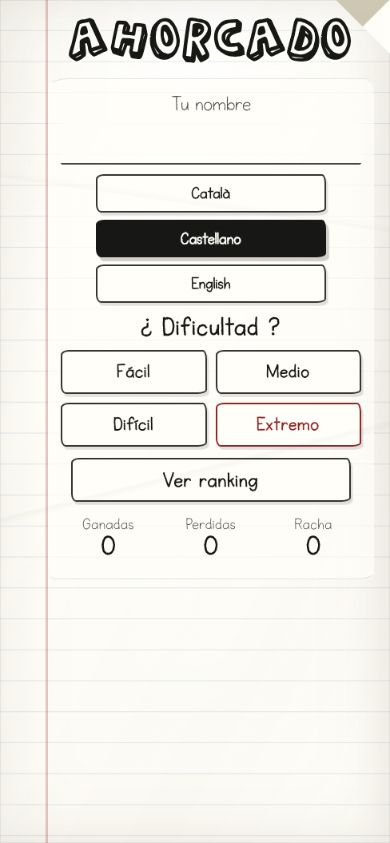
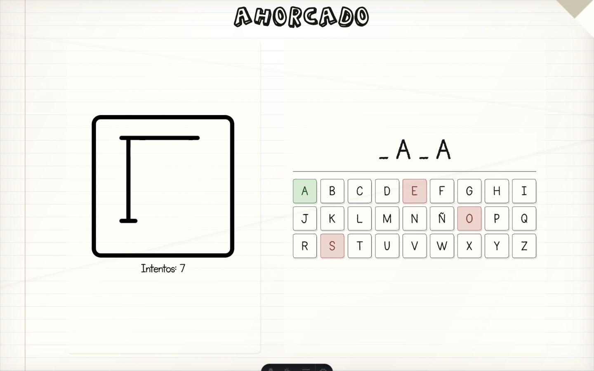

# Ahorcado Frontend

Juego del Ahorcado responsive construido con Astro y React, con estética de libreta dibujada a lápiz.

[Jugar en producción](https://hangman-frontend-sable.vercel.app) · [API en Render](https://hangman-backend-1.onrender.com/actuator/health)

---

## Funcionalidades

- Cuatro dificultades: Fácil, Medio, Difícil y Extremo contra reloj.
- Palabras en castellano, catalán e inglés.
- Teclado físico y virtual con feedback visual de aciertos y fallos.
- Partida reanudable mediante `localStorage`, estadísticas locales y racha.
- Nombre de jugador sin login, sesión anónima por navegador y ranking global top 5.
- Animaciones de dibujo, revelado de letras y modales de victoria/derrota.
- La palabra se muestra al ganar o perder en cualquier dificultad e idioma.
- Diseño responsive comprobado en escritorio, tablet y móvil.
- Interfaz accesible con etiquetas ARIA, foco visible y reducción de movimiento.

---

## Stack

- Astro 5.10 y Vite.
- React 19.
- CSS modular por áreas, sin framework visual.
- Vitest, Testing Library y jsdom.
- Despliegue del frontend en Vercel; backend Spring Boot en Render.

---

## Desarrollo local

1. **Clona el repositorio**

   ```bash
   git clone https://github.com/srcArq/hangman-frontend.git
   cd hangman-frontend
   ```

2. **Instala dependencias**

   ```bash
   npm install
   ```

3. **Configura las variables de entorno**

   Copia el archivo de ejemplo y define la URL base del backend:

   ```bash
   cp .env.example .env
   ```

   Después edita `.env` y ajusta `PUBLIC_API_URL` a tu backend
   (`http://localhost:8080` en desarrollo local):

   ```bash
   PUBLIC_API_URL=http://localhost:8080
   ```

   `PUBLIC_API_URL` es pública y termina en el bundle del navegador. No debe contener secretos.

4. **Arranca el servidor de desarrollo**

   ```bash
   npm run dev
   ```

   La aplicación quedará disponible en la URL indicada por la consola
   (por defecto `http://localhost:4321`).

5. **Genera la build de producción**

   ```bash
   npm run build
   ```

   Previsualiza la build de producción en local:

   ```bash
   npm run preview
   ```

6. **Ejecuta los tests**

   ```bash
   npm test
   ```

---

## Despliegue

El frontend se publica en Vercel desde la rama `main`. La variable
`PUBLIC_API_URL` debe apuntar a `https://hangman-backend-1.onrender.com` en los
entornos de producción y preview que deban usar el backend real.

---

## Capturas actuales

### Inicio móvil

<p align="center">
  
</p>

### Partida en escritorio

<p align="center">
  
</p>

Las capturas fueron regeneradas desde la aplicación local validada.

