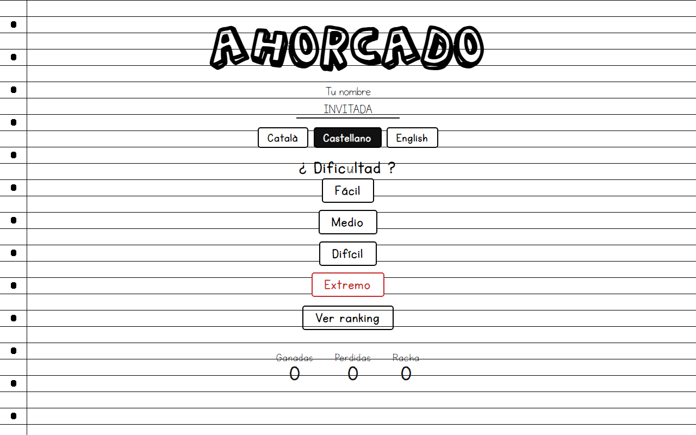
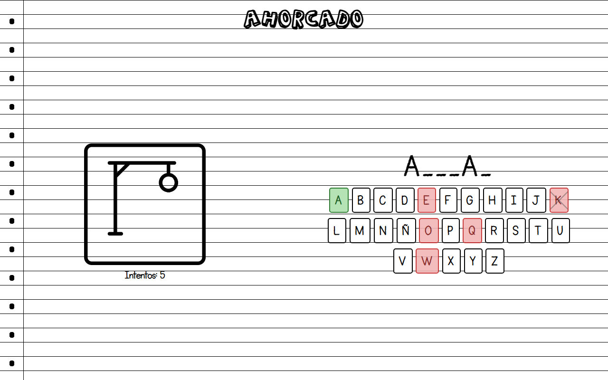
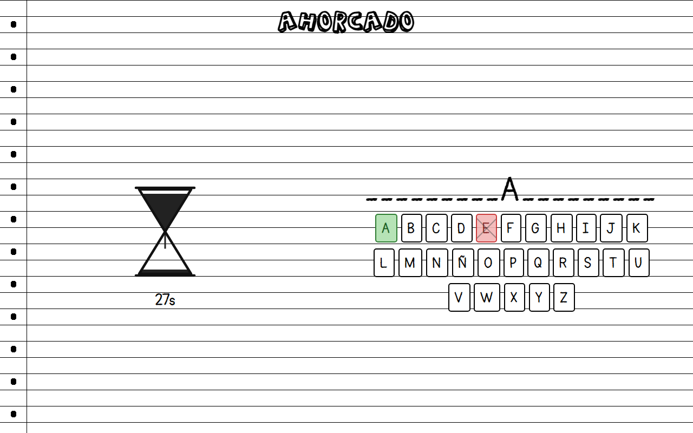
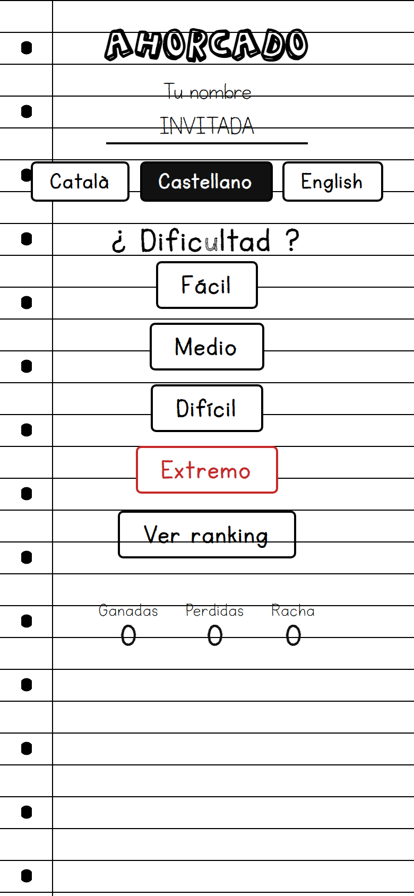
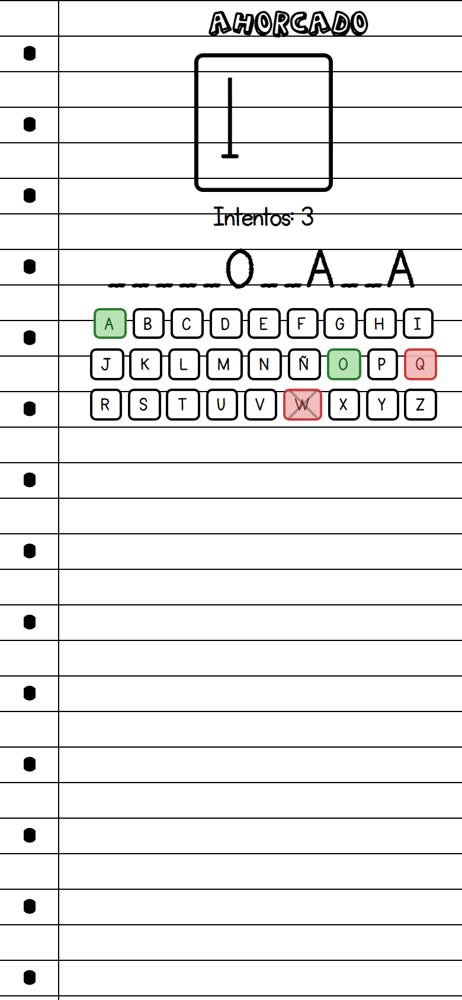

# Hangman Frontend

_A browser game of Hangman ("Ahorcado"), built with Astro and React. The UI is a
single React island that talks to the [Hangman backend](https://github.com/srcArq/hangman-backend)
(Spring Boot) over a small REST API._

[Live Demo → 🌐](https://hangman-frontend-sable.vercel.app)

> The demo needs the backend to be awake to start a game. The backend runs on a
> free hosting plan that sleeps after inactivity, so the first request can take
> ~30–50 s while it wakes up.

---

## ✨ Features

All of the following were verified against the implementation in `src/components`.
The flows shown in the screenshots below were exercised locally; the global
ranking was verified through code and tests only, not end‑to‑end.

- **Four difficulty levels** — `Fácil`, `Medio`, `Difícil` and `Extremo`.
  The first three differ in the number of wrong guesses allowed (the backend
  grants 10 / 7 / 5 attempts respectively).
- **Extreme mode (against the clock)** — instead of a fixed number of attempts,
  a countdown drives the game: it starts at **30 s**, a correct letter adds
  **+4 s**, a wrong letter subtracts **−6 s**, and the hourglass turns red and
  shakes when **≤ 8 s** remain. Running out of time ends the game. Extreme mode
  shows an animated **hourglass** instead of the hangman drawing.
- **Three word languages** — `Català` (CA), `Castellano` (ES) and `English` (EN),
  selectable on the home screen and remembered between sessions.
- **Player name** — a name field (max 20 characters) stored in `localStorage`;
  it is sent with a win so the player can appear in the global ranking.
- **Global ranking** — a "Ver ranking" view that fetches the backend's top‑5
  leaderboard.
- **Local scoreboard** — wins (`Ganadas`), losses (`Perdidas`) and current
  streak (`Racha`), persisted in `localStorage`.
- **Resume an in‑progress game** — a normal (non‑Extreme) game is saved to
  `localStorage` and restored automatically on the next visit.
- **On‑screen and physical keyboard** — click the letters or type them; the
  keyboard includes **Ñ**, marks confirmed letters green (hit) / red (miss), and
  disables letters already tried.
- **Animated hangman drawing** — the figure advances as wrong guesses accumulate
  (levels 1–3), with a win/lose modal at the end.
- **Network resilience** — a connection error on start shows a retry prompt; a
  failed letter guess is reverted so it can be pressed again (optimistic UI).
- **Accessibility & responsive layout** — ARIA labels/roles, a native
  `<dialog>` modal, and CSS media queries so the "notebook" layout fits both
  desktop and mobile without scrolling.

---

## 🎮 Game flow

1. Enter a name and pick a language.
2. Choose a difficulty (`Fácil` / `Medio` / `Difícil` / `Extremo`).
3. Guess letters with the mouse or keyboard. Correct letters are revealed;
   wrong ones cost an attempt (normal modes) or time (Extreme).
4. Win by revealing the whole word, or lose by running out of attempts/time.
5. A modal offers **"Jugar de nuevo"**; the scoreboard and (on a win) the global
   ranking are updated.

---

## 🛠️ Tech stack

- **Framework:** [Astro](https://astro.build) `^5.10` with a single static page
  (`src/pages/index.astro`) that hydrates one React island (`client:load`).
- **UI:** [React](https://react.dev) `^19` via `@astrojs/react`.
- **Styling:** plain CSS (`src/styles/*` plus `public/assets/styles/global.css`),
  with custom fonts under `src/styles/fonts`.
- **Build:** Vite‑powered Astro, `output: "static"`.
- **Deploy:** Vercel (`vercel.json` uses `@vercel/static-build` → `dist/`).
- **Tests:** [Vitest](https://vitest.dev) + Testing Library (`jsdom`).

---

## ⚙️ Configuration (`PUBLIC_API_URL`)

The frontend needs the backend base URL. Copy the example and set it:

```bash
cp .env.example .env
```

```bash
# .env
PUBLIC_API_URL=http://localhost:8080     # local backend
# PUBLIC_API_URL=https://your-backend.example.com  # deployed backend
```

`PUBLIC_API_URL` is read via `import.meta.env.PUBLIC_API_URL`. The `PUBLIC_`
prefix means Astro **exposes it to the browser**, so it must not hold secrets.
When deploying on Vercel, define `PUBLIC_API_URL` in the project's environment
variables.

The client calls these backend endpoints:

| Action | Request |
| ------ | ------- |
| Start a game | `POST ${PUBLIC_API_URL}/api/selectLevel` `{ level, language }` |
| Guess a letter | `POST ${PUBLIC_API_URL}/api/checkLetter` `{ token, letter }` |
| Record a win | `POST ${PUBLIC_API_URL}/api/score` `{ name, token }` |
| Read the ranking | `GET ${PUBLIC_API_URL}/api/ranking` |

---

## 🚀 Getting started

```bash
git clone https://github.com/srcArq/hangman-frontend.git
cd hangman-frontend
npm install
cp .env.example .env        # then set PUBLIC_API_URL

npm run dev                 # dev server (default http://localhost:4321)
npm run build               # production build → dist/
npm run preview             # serve the built site locally
npm run test                # run the Vitest suite once
```

---

## ✅ Tests & build

Verified locally during the audit (Node 22, npm 11):

- `npm run test` → **34 tests passing** across 5 files
  (`AttempsImage`, `KeyBoard`, `LevelSelector`, `Loader`, `Modal`).
- `npm run build` → static build completed successfully (1 page, client bundle
  emitted to `dist/`).

The test suite covers component behaviour (keyboard incl. Ñ, physical‑key input,
hit/miss marking, retry‑on‑failure, the difficulty selector, the attempts‑image
mapping, the modal and the loader). Full end‑to‑end play was exercised manually
against a locally running backend.

---

## 🔗 Relationship with the backend

This app is the client half of a two‑repo product. The gameplay logic and word
lists live in the **[hangman-backend](https://github.com/srcArq/hangman-backend)**
(Spring Boot). The word is never sent to the browser in plain text: the backend
keeps the whole game inside an encrypted token that travels with each request,
and the frontend only ever sees the masked word, the remaining attempts and the
status. See the backend README for the full API contract.

---

## 🖼️ Screenshots

Real captures taken with Playwright against the app running locally (preview
build talking to a local backend). Sources in [`docs/screenshots`](docs/screenshots).

| Home (desktop) | In‑game (desktop) | Extreme mode (desktop) |
| --- | --- | --- |
|  |  |  |

| Home (mobile) | In‑game (mobile) |
| --- | --- |
|  |  |
